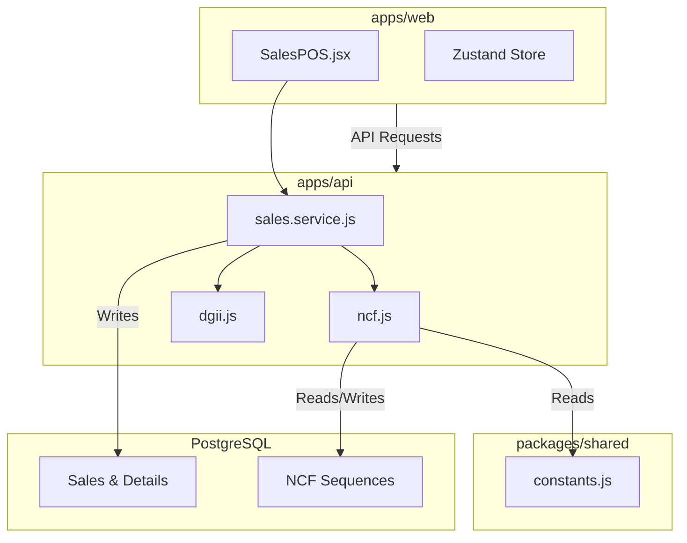

# SalesPro v2 - Technical Context for e-CF Implementation

## Resumen ejecutivo de la arquitectura
SalesPro v2 es un sistema de gestión de ventas (POS) estructurado como un monorepo utilizando `npm workspaces`.
- **Backend:** Node.js, Express, Prisma ORM, PostgreSQL. Enfocado en servicios modulares (`modules/*`) con validación de entrada mediante Zod y middlewares de seguridad (Rate Limiting, Helmet).
- **Frontend:** React 19, Vite, Tailwind CSS, Zustand para gestión de estado, y TanStack Query para el manejo de datos de servidor.
- **Flujo:** La API expone endpoints RESTful. El frontend actúa como un cliente ligero. La persistencia se gestiona vía Prisma ORM con migraciones estructuradas.

## Estructura de proyecto 
```
salespro-v2/
├── assets/
│   └── .aistudio/
├── dist/
├── node_modules/
├── prisma/
│   ├── migrations/
│   ├── dev.db
│   ├── schema.prisma
│   ├── schema.sqlite.prisma
│   └── seed.js
── src/
│   ├── components/
│   │   ├── ErrorBoundary.jsx
│   │   ├── Modal.jsx
│   │   └── SVGCharts.jsx
│   ├── config/
│   │   ├── constants.js
│   │   ├── db.js
│   │   └── env.js
│   ├── hooks/
│   │   └── queries.js
│   ├── modules/
│   │   ├── auth/
│   │   │   ├── auth.controller.js
│   │   │   ├── auth.routes.js
│   │   │   ├── auth.service.js
│   │   │   └── validators.js
│   │   ├── categories/
│   │   │   ├── categories.controller.js
│   │   │   ├── categories.routes.js
│   │   │   ├── categories.service.js
│   │   │   └── validators.js
│   │   ├── customers/
│   │   │   ├── customers.controller.js
│   │   │   ├── customers.routes.js
│   │   │   ├── customers.service.js
│   │   │   └── validators.js
│   │   ├── inventory/
│   │   │   ├── inventory.controller.js
│   │   │   ├── inventory.routes.js
│   │   │   ├── inventory.service.js
│   │   │   ── validators.js
│   │   ├── products/
│   │   │   ├── products.controller.js
│   │   │   ├── products.routes.js
│   │   │   ├── products.service.js
│   │   │   └── validators.js
│   │   ├── reports/
│   │   │   ├── reports.controller.js
│   │   │   ├── reports.routes.js
│   │   │   └── reports.service.js
│   │   ├── sales/
│   │   │   ├── sales.controller.js
│   │   │   ├── sales.routes.js
│   │   │   ├── sales.service.js
│   │   │   └── validators.js
│   │   └── users/
│   ├── pages/
│   │   ├── Categories.jsx
│   │   ├── Customers.jsx
│   │   ├── Dashboard.jsx
│   │   ├── Inventory.jsx
│   │   ├── Products.jsx
│   │   ├── Reports.jsx
│   │   ├── SalesPOS.jsx
│   │   └── Users.jsx
│   ├── services/
│   │   └── api.js
│   ├── shared/
│   │   ├── exceptions/
│   │   │   ── AppError.js
│   │   ├── middleware/
│   │   │   ├── audit.js
│   │   │   ├── auth.js
│   │   │   ├── errorHandler.js
│   │   │   ├── rateLimiter.js
│   │   │   └── validate.js
│   │   └── utils/
│   │       ├── asyncHandler.js
│   │       ├── crypto.js
│   │       ├── dgii.js
│   │       ├── helpers.js
│   │       ├── jwt.js
│   │       ├── logger.js
│   │       └── ncf.js
│   ├── stores/
│   │   └── authStore.js
│   ├── app.js
│   ├── App.jsx
│   ├── index.css
│   ├── main.jsx
│   ├── server.js
│   └── types.js
├── .env
├── .env.example
├── .eslintrc.json
├── .gitignore
├── .prettierrc
├── index.html
├── metadata.json
├── package-lock.json
├── package.json
── postcss.config.js
├── README.md
├── server.js
├── tailwind.config.js
├── test-api.js
├── test-dashboard.js
├── test-login.js
├── test-sale.js
└── vite.config.js
```

## Diagrama de flujo transaccional y estructura



## Tabla de modelos de BD (Relevantes para facturación)

| Entidad | Campos Clave | Relaciones |
| :--- | :--- | :--- |
| `Sale` | `id`, `invoiceNumber`, `ncfType`, `customerId`, `subtotal`, `tax`, `total` | BelongsTo: Customer, User; HasMany: SaleDetail |
| `SaleDetail` | `id`, `saleId`, `productId`, `quantity`, `unitPrice`, `unitCost`, `subtotal` | BelongsTo: Sale, Product |
| `Customer` | `id`, `documentId`, `name`, `rnc` | HasMany: Sale |
| `NCFSequence` | `id`, `ncfType`, `prefix`, `current` | - |
| `Product` | `id`, `code`, `name`, `costPrice`, `salePrice`, `stock` | HasMany: SaleDetail, InventoryLog |

## Lista de archivos críticos

*   **`apps/api/src/modules/sales/sales.service.js`**: Contiene la lógica central de creación de ventas (`createSale`), cálculo de impuestos (ITBIS) y asignación de NCF.
*   **`apps/api/src/shared/utils/ncf.js`**: Gestiona la lógica de secuencias de NCF (upsert de secuencias, formato).
*   **`apps/api/src/shared/utils/dgii.js`**: Validadores para RNC y Cédula.
*   **`apps/web/src/pages/SalesPOS.jsx`**: Flujo de frontend para carrito, selección de cliente y checkout.
*   **`apps/web/src/components/SaleDetailModal.jsx`**: Visualización de factura y generación de PDF.
*   **`packages/shared/constants.js`**: Definiciones globales de `NCF_TYPES`, `TAX_RATE` y prefijos.

## Puntos de Integración e-CF

1.  **Generación de UBL 2.1:** Inyectar un servicio de transformación en `sales.service.js` después de calcular los totales y antes de la persistencia de la venta.
2.  **Firma Digital:** Implementar un middleware o servicio dedicado para firmar el XML generado. Integrar este paso tras la generación del UBL.
3.  **Comunicación DGII:** Crear un nuevo módulo (`apps/api/src/modules/dgii/`) para gestionar el envío de facturas firmadas, consulta de estatus y recepción de respuestas (aprobación/rechazo).
4.  **Gestión de NCF:** El sistema actual ya maneja secuencias (`ncf_sequences`), pero necesitará actualizarse para sincronizar el estado del NCF con la DGII.

## Brechas Técnicas Identificadas

*   **Servicio de Firma:** No existe mecanismo actual para firma digital (XAdES/XMLDSig).
*   **Consumo Web Services DGII:** No hay integración con las APIs de la DGII para envío de facturas (e-CF) ni validación en tiempo real de RNCs.
*   **B16/B17:** Aunque el modelo tiene `NCFType` (incluye B16), la lógica de generación de notas de crédito es preliminar y requiere alineación completa con el estándar e-CF.
*   **Contingencia:** No existe lógica para el manejo de facturas en modo offline o contingencia (emisión de facturas sin firma inmediata).
*   **Conciliación:** Falta módulo para conciliar los e-CF emitidos en el sistema con las facturas aprobadas por la DGII.
